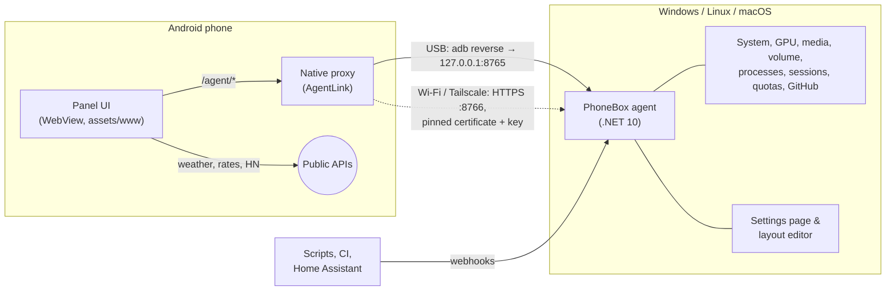

<p align="center"></p>

<h1 align="center">PhoneBox</h1>

<p align="center"><b>Turn an old Android phone into a desk panel for your computer: Windows, Linux or macOS.</b><br>
Widgets for your PC, AI coding sessions, music, weather and anything you push to it. USB or Wi-Fi, no cloud.<br>
<a href="https://ersinkoc.github.io/phonebox/"><b>▶ Try the live demo in your browser</b></a></p>

<p align="center">
  <a href="https://github.com/ersinkoc/phonebox/actions/workflows/build.yml"></a>
  <a href="https://github.com/ersinkoc/phonebox/releases/latest"></a>
  
  
  <a href="LICENSE"></a>
</p>

<p align="center"></p>

PhoneBox has two parts: a small **Android app** that runs full screen on the phone, and an **agent** on the computer
(Windows, Linux or macOS) that feeds it over the USB cable (or over Wi-Fi / Tailscale after pairing once). You design
the pages in a visual editor on the PC: **113 widgets**, **30 templates**, as many pages as you like.

- **Your PC at a glance**: CPU, GPU, RAM, disks, network and ping; the heaviest apps, with "end one instance / end all".
- **AI coding**: Claude and Codex quotas with a burn-rate forecast; Codex remaining allowance and local session token details; tap a session to see its model, timing, tokens, context window and recent tool — the phone
  buzzes when one finishes or needs you, and Claude Code's permission prompts show up with **Allow** / **Deny**.
  GitHub review requests and your pull requests with CI status.
- **Desk companion**: now playing with controls and volume, clocks, weather, sun & moon, air quality, calendar,
  pomodoro, timers, checklists, notes, a breathing exercise.
- **Stream Deck–style keys** that launch apps, URLs or built-in actions on the PC.
- **Webhooks and rules**: scripts, CI and Home Assistant push values and notifications; rules switch pages calmly
  when something happens (a call, music, an AI session waiting for you).

<p align="center"><a href="docs/tour-0.6.mp4"></a><br>
<sub>A tour through the pages (made-up data): a notification, a permission prompt, a rule switching pages calmly. <a href="docs/tour-0.6.mp4">Video (MP4)</a></sub></p>

**Contents**: [Quick start](#quick-start) · [Pages & templates](#pages--templates) · [Widgets](#widgets) ·
[Layout editor](#layout-editor--settings) · [Claude Code prompts](#claude-code-permission-prompts) · [Webhooks](#webhooks) · [Rules](#rules) · [Wi-Fi & Tailscale](#wi-fi--tailscale) ·
[Updates](#updates) · [How it works](#how-it-works) · [Security](#security--privacy) · [FAQ](#faq--troubleshooting) ·
[Development](#development)

## New in 0.7.3

Fixes an immediate launch crash on Android 9 and 10. Full-screen mode now uses the compatible immersive API on
these versions; Android 11+ keeps the existing behavior. Android API compatibility lint now blocks CI and releases.

### Native Antigravity quotas (0.7.2)

Native Antigravity quota monitoring now works without CodexBar, including signed-in `agy` CLI installations on
Windows. Session and weekly usage come from measured quota data; missing readings are not shown as unused quota.
See [native Antigravity quotas](#widgets) and the [changelog](CHANGELOG.md) for setup and compatibility details.

### Smart Stack and session details (0.7.0)

| Smart Stack and quotas | Codex session details |
|---|---|
|  |  |

These screenshots use made-up demo data. See the [changelog](CHANGELOG.md) for all changes.

## Quick start

This fork is built from source only: nothing downloads or runs ready-made release files (see [Updates](#updates)).

You need an Android 9+ phone with [USB debugging](https://developer.android.com/studio/debug/dev-options) turned on,
the [.NET 10 SDK](https://dotnet.microsoft.com/download) and `adb`.
The source installers below build the agent locally. To build the phone app, also install **JDK 17** and
**Android SDK Platform 35** (for example through Android Studio), set `JAVA_HOME`, and point `ANDROID_HOME` or
`android/local.properties` (`sdk.dir`) at the SDK. The installers can use a release APK from `dist/`; the Windows
installer rebuilds it when Android sources are newer, or when `-BuildApk` is supplied.

**Windows 10/11**

```powershell
winget install Microsoft.DotNet.SDK.10 Google.PlatformTools   # .NET 10 and adb
git clone https://github.com/prnvmrli/phonebox
cd phonebox
.\scripts\install.ps1 -Apk -Autostart   # agent + phone app, start with Windows (add -Serial <id> if several devices are connected)
```

**Linux** (Ubuntu, Debian, Fedora, Arch…) **and macOS**

```sh
sudo apt install adb playerctl          # Fedora: android-tools playerctl · macOS: brew install android-platform-tools nowplaying-cli
git clone https://github.com/prnvmrli/phonebox
cd phonebox
./scripts/install.sh --apk              # agent + phone app; on macOS also ~/Applications/PhoneBox.app
                                        # add --autostart to start at login (systemd user service / launchd agent)
```

On macOS, opening **PhoneBox.app** starts the agent and opens the panel on the phone, clicking its Dock icon opens the
settings, and quitting it stops the agent. The Android build needs JDK 17: run the installer with
`JAVA_HOME=/opt/homebrew/opt/openjdk@17` if your default Java is newer.

Plug the phone in, or connect it without a cable through **Wireless debugging** (Android 11+: Developer options ›
Wireless debugging › Pair device with pairing code, then `adb pair <ip>:<port>` once): it wakes up and opens the panel. The settings are at <http://127.0.0.1:8765> (on Windows also
from the tray icon). `scripts/uninstall.ps1 [-Purge] [-Apk]` / `scripts/uninstall.sh [--purge] [--apk]` remove
everything again.

<details><summary><b>What works where</b></summary>

| | Windows | Linux | macOS |
|---|---|---|---|
| CPU, RAM, network, disks, ping | ✓ | ✓ | ✓ |
| CPU temperature | LibreHardwareMonitor | ✓ (hwmon) | — |
| GPU usage | NVIDIA (`nvidia-smi`) | NVIDIA (`nvidia-smi`) | Apple silicon (`ioreg`) |
| Now playing + controls | ✓ (any app) | ✓ (MPRIS via `playerctl`) | System media, including browser video, with `nowplaying-cli`; Spotify and Music fallback |
| Volume | ✓ | ✓ (`wpctl` / `pactl`) | ✓ |
| Processes, end one / all | ✓ | ✓ (your own) | ✓ (your own) |
| App icons | ✓ | ✓ (icon theme) | ✓ (app bundles) |
| Shortcuts, lock, screen off | ✓ | ✓ (`loginctl`, `xset`) | ✓ (`open`, `pmset`) |
| Command widgets | PowerShell | bash | zsh |
| Claude / Codex quotas & sessions, GitHub, webhooks | ✓ | ✓ | ✓ (Claude token from the Keychain) |
| Tray icon | ✓ | — (settings in the browser) | — |
| Start at login | Startup folder | systemd user service | launchd agent |

On macOS, `nowplaying-cli` supplies system media metadata and cover art. The agent labels matching Safari or Chrome tabs as YouTube or YouTube Music. The progress bar advances from the last position supplied by macOS; Safari may report an outdated starting position. Volume follows the selected system output. When macOS does not expose its volume, an optional `m1ddc` installation can read it from a compatible display; display volume is read only in PhoneBox. Unsupported outputs show `n/a`. Apple silicon GPU usage comes from IORegistry when macOS exposes it; temperature, power and VRAM figures may remain unavailable.

</details>

Optional extras that light up more widgets: an NVIDIA GPU (`nvidia-smi`), the [GitHub CLI](https://cli.github.com)
(`gh auth login`), Claude Code, Codex, and [LibreHardwareMonitor](https://github.com/LibreHardwareMonitor/LibreHardwareMonitor)
with its web server on port 8085 for the CPU temperature.

## Appearance

Set corner radius, widget spacing, inner padding, page padding, borders and shadows in **Settings → General →
Appearance**. Choose Original, Rounded cards, Flat, Content only or Seamless panel, then customize individual values.
Pages and individual widgets can override global defaults. Live preview shows unsaved changes before Save.
Existing layouts keep their original appearance. See the [appearance guide](docs/APPEARANCE.md).

## Control Deck

Turn a phone into a touch control deck with application audio faders, microphone controls, device selection,
push-to-talk, audio profiles, media controls, soundboard, window and system controls, OBS, meeting shortcuts,
development tasks, MIDI and OSC. Six new templates provide starting layouts; existing layouts are retained.

Open **Settings → General → Control Deck** to define computer-side bindings and capture audio profiles. Add the
matching widgets in Pages. Executable shortcuts and macros are configured in Deck first; phone requests contain
only configured IDs. PC audio listening and hold-to-confirm power buttons require separate desktop opt-ins.

Spotify queue, library and playlist controls need a Spotify Developer Client ID and a connection through the
settings screen. OBS needs obs-websocket and widget control permission. Application routing uses an installed
SoundVolumeView executable; virtual-mixer controls use the installed Voicemeeter Remote DLL. MIDI requires an
output port. Missing integrations display their setup state. See the [setup and platform guide](docs/CONTROL-DECK.md).

## Pages & templates

Every page is a 12 × 6 grid. Start a page from one of the 30 templates (or from scratch) and change anything.

| | |
|---|---|
| **Home** — clock, weather, now playing, CPU / GPU / RAM / network tiles | **Dashboard** — gauges, clock, media and a few shortcut keys |
|  |  |
| **AI quotas** — Claude and Codex limits, reset times, "at this pace: full in 1 d 5 h" | **Sessions** — Claude Code / Codex sessions and GitHub |
|  |  |
| **System** — CPU, GPU, memory, disks, network and ping charts | **Processes** — heaviest apps; tap one to end an instance or all of them |
|  |  |
| **Status** — quota rings, phone battery, top CPU, volume, sessions | **Ambient** — analog clock, sun & moon, air quality, quote, forecast |
|  |  |
| **Markets** — exchange rates, crypto, Hacker News | **Feeds** — values and notifications pushed by webhooks |
|  |  |
| **Daily** — checklist, time progress, timer, counter, stopwatch | **World** — world clocks, hourly forecast, calendar |
|  |  |
| **Music** — a big now-playing card | **Shortcuts** — Stream Deck–style keys |
|  |  |
| **Planner** — next up, month, agenda, checklist | **Automation** — rules, on air, pushed values, device batteries, notifications |
|  |  |
| **Nightstand** — word clock, moon, battery care, next hours | **Deep work** — pomodoro, next up, sessions, quota ring, rules |
|  |  |

More templates: **Clock**, **Focus** (pomodoro + note), **Calm** (breathing), **DevOps** (command widgets) and
**Weekend** (forecast, music, moon, analog clock, quote).

**Getting around.** Swipe; press the phone's **volume keys** to flip pages; tap the page dots (or long-press an empty
spot) for an overview of all pages and jump straight to one. Webhooks and rules can switch pages too; they count down
first (*"switching to AI in 3…"*, with Stay and Go now) and never pull a page away while you are using the panel. The
panel returns to the home page when idle (each page can stay longer, or for good), can dim to a clock at night and
keeps the screen on.

<p align="center"></p>

## Widgets

| Category | Widgets |
|---|---|
| **Time** | Clock (with status line and weather) · Analog clock (any time zone) · **Word clock** · World clocks · Calendar · **Next up** · Time progress (day / week / month / year) · Countdown · Pomodoro · Quick timer · Stopwatch |
| **Weather & sky** | Weather · Forecast (hourly / 7 days) · Sun & moon (daylight left, UV, moon phase) · **Moon** · Air quality (European AQI, PM2.5, PM10, O₃, NO₂) |
| **Computer** | **Rules** (which hold, pause) · **Battery care** · On air (microphone / camera / OBS) · OBS Studio (live, recording, scenes) · Device batteries (headphones, mice, keyboards) · Docker (containers, start / stop) · Metric tile · Gauge · Chart · Memory & disks · Top processes · Processes · Now playing · Volume · Shortcut grid · Big button · **Command** (PowerShell / bash / zsh output, refreshed every N seconds) |
| **AI & code** | AI quotas · Quota ring · AI sessions · GitHub |
| **Personal** | **Agenda** (Google / Outlook / iCloud calendars) · Note · Checklist (resets daily) · Counter · Breathe · Quote · Title · Phone battery |
| **Web & data** | **Custom HTML** (your own widget, sandboxed) · **Home Assistant** (entities, tap to switch) · **Pushed value** · **Notifications** (both fed by [webhooks](#webhooks)) · Hacker News · Exchange rates (ECB) · Crypto prices · Image / webcam |

Widgets scale to the size you give them. Weather, air quality, rates, crypto and Hacker News come straight from free
public APIs ([Open-Meteo](https://open-meteo.com), [Frankfurter](https://frankfurter.dev), [CoinGecko](https://www.coingecko.com),
[HN](https://github.com/HackerNews/API)) on the phone, without API keys, and keep their last data when offline.

**Smart Stack** combines up to 12 widgets in one slot. Add it from the Layout category, then drag widgets into it or
use its picker. Reorder cards, open their settings, or disable individual cards. Tap the dots or swipe vertically to
change cards; horizontal swipes still change pages. Focused controls pause rotation. Command widgets belong directly
on a page rather than inside a stack.

**CodexBar** is an optional source: install its `codexbar` CLI on the computer and the agent reads `usage --json`.
The CodexBar template and quota widget can show Claude, Codex and Antigravity with configurable provider rotation.
Local Claude, Codex and Antigravity sources keep refreshing when CodexBar is absent, fails, or reports stale data. General settings
provide defaults; a widget's own options override them, including an empty provider selection.
The checked [CodexBar 0.84.0 release](https://github.com/steipete/CodexBar/releases/tag/v0.84.0) supplies macOS and Linux
CLI binaries. Windows continues to use native local sources when no compatible CLI is installed.

**Native Antigravity quotas** use a running app/hub's advertised HTTP port and CSRF token, or a signed-in
`agy` CLI (1.1.11 or later). The CLI fallback runs `agy -p /usage --output-format json`, without a model prompt,
and also finds the standard Windows installation in `%LOCALAPPDATA%\agy\bin`. Run `agy` in your terminal to sign
in if needed. The agent reads measured session and weekly buckets, plus the plan when the local server provides it;
CLI reports without plan metadata keep the neutral Antigravity title. Older IDE servers can supply model quotas
through `GetUserStatus`; unavailable measurements are skipped, and weekly limits are never invented. Refresh
failures retain the last measurements with an error. HTTPS-only endpoints without a compatible CLI can use CodexBar.

Tap an AI session to see its model, timing and token details. Token counters describe the local session rather than
the account allowance. Prompt/response text and tool arguments are not included in this panel data.

## Layout editor & settings

Double-click the tray icon on Windows (or open <http://127.0.0.1:8765>):

<p align="center"></p>

- **Pages**: add pages from templates, reorder, show/hide, export and import them as files, choose how long each page
  may stay before the panel goes home; arrange widgets on a phone-sized canvas (drag to move, drag
  the corner to resize) and set their options. The widget palette is grouped by category and searchable.
  **Live preview** swaps the canvas for the real panel with your unsaved changes and live data.
- **Rules**: automations, see [Rules](#rules).
- **Shortcuts**: add, edit, reorder and test keys (label, emoji, colour). A key runs a program, presses a key
  combination (`ctrl+shift+m`), types text or runs a macro (keys, text, waits, other shortcuts); on / off keys show
  their state on the phone (mute does by itself, others from a pushed value).
- **Webhooks**: the webhook key, copy-paste examples, test buttons and the values pushed so far.
- **General**: weather location search; calendars (ICS links from Google, Outlook or iCloud), Home Assistant and OBS
  connections; night mode; theme and accent colour, orientation (landscape, portrait or both), clock seconds,
  vibration, volume-key paging and the phone's sensors (brightness that follows the room, the night screen when the
  room goes dark, wave to wake it); [page switching](#rules) (home page, countdown, back home after);
  kiosk options (screen pinning, the panel as the phone's home screen so it starts after a reboot, keep the phone
  awake on the charger; no root needed); on macOS, optionally follow the computer lock (sleep the phone on lock,
  wake it and open PhoneBox on unlock, with an ADB connection; phones secured by a PIN or password must be unlocked
  manually). Lock sync needs the agent to run in the macOS GUI session; [battery care](#rules);
  [Claude Code permission prompts](#claude-code-permission-prompts);
  phones (several at once, each with its own pages); Wi-Fi & Tailscale.
- **Advanced**: the raw JSON.

Settings live in `%APPDATA%\PhoneBox\config.json` (Linux: `~/.config/PhoneBox`, macOS: `~/Library/Application Support/PhoneBox`);
the phone picks up changes within a few seconds.

## Claude Code permission prompts

When Claude Code asks for permission (run a command, edit a file, use an MCP tool…), the phone shows the request —
project, tool and the command or file — with **Allow** and **Deny**. Turn it on in **Settings › General › Claude Code
permission prompts** and press *Install hook*: PhoneBox adds a `PermissionRequest` hook to `~/.claude/settings.json`
(and keeps a backup next to it as `settings.json.phonebox.bak`). If the phone is not connected or nobody answers in
time, the hook returns no decision and Claude Code asks in the terminal as usual. Optionally only when you have been
away from the keyboard for a minute.

## Webhooks

The agent accepts data as well as serving it, so anything that can make an HTTP request can put things on the panel:

```sh
curl -X POST http://127.0.0.1:8765/api/push/temperature -d 21.5                     # shown by a "Pushed value" widget with key "temperature"
curl -X POST http://127.0.0.1:8765/api/push/build -H "Content-Type: application/json" \
     -d '{"value":"passed","sub":"main · 3m 12s"}'
curl -X POST "http://127.0.0.1:8765/api/push/door?ttl=600" -d open                    # expires after 10 minutes
curl -X POST http://127.0.0.1:8765/api/notify -H "Content-Type: application/json" \
     -d '{"title":"Deploy","text":"Production is live","level":"ok","page":"feeds"}' # toast + vibration (+ switch page)
curl -X POST http://127.0.0.1:8765/api/goto/music                                     # switch the phone to a page (id or number)
curl -X POST "http://127.0.0.1:8765/api/goto/music?countdown=0"                        # …without the on-screen countdown
curl -X POST http://127.0.0.1:8765/api/refresh                                        # refresh quotas/GitHub and the panel now (?reload=1 reloads it)
```

| Payload field | Meaning |
|---|---|
| `value`, `title`, `sub`, `unit`, `icon`, `color` | What the widget shows. Plain text or a number works too. |
| `level` | `ok` / `warn` / `error` colours it; values like `passed`, `failed`, `running` are coloured automatically. |
| `progress` | 0–1 or 0–100: a bar under the value, or the ring in gauge style. |
| `items` | A list (strings or `{label, value, level}`) for the list style. |
| `ttl` | Seconds until the value disappears (also `?ttl=`). |

Notifications take `title`, `text`, `level`, `vibrate`, `seconds`, `wake` (light up the night screen) and `page`.
`GET /api/push` lists the values and `DELETE /api/push/<key>` removes one; values survive restarts.

From this PC no key is needed. With Wi-Fi on, other machines on the network or Tailscale can use the same endpoints
on `https://<pc>:8766` with the **webhook key** from the settings (`Authorization: Bearer <key>`, or `?token=<key>`
for senders that cannot set headers). That key opens only the webhook endpoints, never the phone API.

## Rules

**Settings › Rules** lets the panel react to what happens on the computer. Each rule is *when → then*:

| When | Then |
|---|---|
| an AI session needs you / is working (optionally for some projects) | show a page |
| music or video plays (optionally in some apps: `Spotify\|Music`) | show a notification (`{detail}` = what happened) |
| an app is running (`zoom\|Teams\|obs64`) | push a value (e.g. `onair`, shown by a Pushed value widget) |
| the microphone / the camera is in use (Windows, Linux) | |
| a calendar event is on (optionally by title) | |
| OBS is recording or streaming | |
| the CPU stays above a percentage for 15 s | |
| you have been away from the keyboard for N minutes | |
| it is between two times (`22:00-07:00`) | |
| a pushed value is on, or above / below / equal to a value (a webhook from Home Assistant, a doorbell…) | run a shortcut |
| an AI quota is above a percentage | |
| a GitHub review is requested · CI fails on my pull request | |
| a device battery is low · the network is slow or unreachable | |
| always (with the days and hours below, for schedules) | |

Every rule can also be limited to **some days** and **some hours**, act only when its condition **lasts N seconds**,
**rest** for a while before acting again, and has a **priority** and its own **countdown** for page switches.

**Page switches are calm.** The phone counts down before a rule changes the page (*"Claude needs me — switching to
AI in 3…"*, tap **Stay** to keep the page or **Go now**), waits while you are using the panel, keeps a minimum time
between two automatic switches and lets the higher-priority rule go first; rules that end before their turn are
dropped, so a burst of rules never bounces the screen back and forth. Settings › General › Page switching sets the
countdown, how long to wait after a touch, the minimum time between switches, the home page and how long a rule may
keep its page. The phone's overview (and the Rules widget) pauses all rules for an hour.

With **only while it lasts**, the effect ends with the condition: the phone goes back to the page it was on (unless
you moved on yourself) and stays on the rule's page instead of returning home when idle; a pushed value is removed
again. The editor starts from examples (Claude needs me → AI page, music → Music page, on air during calls, CPU busy,
away → Ambient, evenings → Calm, doorbell, quota warning, review requested, CI failed, workday mornings, low battery,
too warm) and has a Test button for each rule.

**Battery care** (Settings › General) keeps the phone's battery between two levels, 50–80 % by default, so a panel
that is always plugged in lasts longer. Phones cannot stop charging without root, so PhoneBox switches the power
where it comes from: a smart plug in Home Assistant, or two shortcuts (for example `uhubctl` for a USB hub with
switchable ports). The panel keeps running over Wi-Fi while the USB power is off.

## Wi-Fi & Tailscale

Turn on **Settings › General › Wi-Fi & Tailscale**, restart the agent when asked, and plug the phone in once. Over
USB the phone receives the PC's addresses, a secret key and the fingerprint of the agent's self-signed TLS
certificate. When the cable is unplugged it switches to `https://<pc>:8766` automatically and back to USB when it is
plugged in again; the status line shows which one it uses.

- The phone and the PC need to be on the same network. If they are not (separate Wi-Fi networks, another
  building…), install [Tailscale](https://tailscale.com) on both: the agent offers its Tailscale address too.
- Windows Firewall asks once when Wi-Fi is turned on; allow it for the network types you use.
- The screen stays on, so the phone still needs a charger — just not necessarily the PC.

With several computers (each paired once over USB), the page overview on the phone lists them and switches between
them over Wi-Fi.

## Updates

This fork has no self-updater: the agent never downloads, installs or runs release files, so only code you built
from this source runs on your computer and phone. To update, pull, read the changes, and run the installer again:

```sh
git pull
./scripts/install.sh --apk   # Windows: .\scripts\install.ps1 -Apk
```

To look at the original project's ([ersinkoc/phonebox](https://github.com/ersinkoc/phonebox)) changes before taking
any: `git remote add upstream https://github.com/ersinkoc/phonebox && git fetch upstream && git log -p main..upstream/main`.
See the [changelog](CHANGELOG.md).

## How it works



- The WebView never talks to the PC directly: requests to `/agent/*` are intercepted by the app and forwarded over
  the adb tunnel (or the pinned HTTPS connection), so there are no CORS, mixed-content or local-network issues.
- Live events (page switches, notifications, permission prompts) arrive over one server-sent-events stream
  (`/api/stream`); plain polling remains as the fallback.
- The agent samples only what is on screen: process lists and command widgets run only while a phone looks at them.

## Security & privacy

- The agent listens on `127.0.0.1` only. Requests with a foreign `Host` header (DNS rebinding) or a cross-site
  `Origin` (CSRF) are rejected; only the settings page itself is accepted from browsers.
- The optional Wi-Fi port (8766) only serves the panel API, only over TLS pinned to the paired certificate, and only
  with the paired key. Settings and shortcut tests stay local. **New key** in the settings unpairs all phones.
- The USB tunnel (`adb reverse`, phone port 8765 → computer port 8767) asks for the same key: every app on the phone
  can reach the tunnel, not only PhoneBox. The agent hands the key to the PhoneBox app through adb, to a receiver only
  adb's shell may send to (it requires the `DUMP` permission, which apps cannot get).
- The phone only ever sends a shortcut **id**; commands are defined on the PC. Command widgets work the same way:
  the phone asks for a widget's output and never sees the command.
- Webhooks from other machines need the separate webhook key, which cannot open the phone API and can be replaced
  on its own.
- Ending processes is limited to your own session, never touches a list of Windows-critical processes, and can be
  switched off in the processes widget's options.
- **Claude Code permission prompts** are opt-in. The hook only posts the request to the agent on `127.0.0.1`; the
  phone can only answer allow or deny for that one request.
- **Claude quota:** read with the OAuth token Claude Code stores in `~/.claude/.credentials.json`, sent only to
  `api.anthropic.com/api/oauth/usage` (the endpoint behind Claude Code's `/usage`). The token is read-only: PhoneBox
  never refreshes it, so it can't interfere with Claude Code. This endpoint is undocumented and may change.
- **Codex quota and sessions** are read from local files in `~/.codex/sessions`; Claude Code sessions from
  `~/.claude/sessions`. Nothing leaves your machine except the requests listed above.
- **Native Antigravity quota:** the agent reads the running Antigravity server's port and CSRF token from its
  process arguments and queries its loopback quota/status API, or invokes the signed-in CLI's structured usage
  command. Only measured quota fields reach the panel; CLI conversation identifiers and token counters are omitted.
  PhoneBox does not manage Google OAuth credentials; the CLI uses its own authentication. CLI auto-updates are
  disabled for these probes.

## FAQ & troubleshooting

<details><summary><b>The panel says "PC not connected".</b></summary>

Is the agent running (tray icon)? Run `adb devices`: the phone must be listed as `device`, not `unauthorized` —
accept the USB debugging prompt on the phone. If several devices are connected, pick the phone under
**Settings › General › Phone connection**. Over Wi-Fi, pair once over USB and allow the agent in Windows Firewall.
</details>

<details><summary><b>The phone keeps dropping off USB.</b></summary>

The panel carries on over Wi-Fi when Wi-Fi is on, and **Settings › General › Phone connection** says what the phone
itself sees: if it is charging but has no USB data connection, the cable or the port only carries power — try another
cable, or a port straight on the computer instead of a hub or a front-panel port.
</details>

<details><summary><b>Some widgets show "—" or "No data".</b></summary>

GPU values need an NVIDIA GPU (`nvidia-smi`) on Windows or Linux, or an Apple silicon Mac exposing GPU utilization through IORegistry. CPU temperature needs LibreHardwareMonitor's web server on port 8085,
GitHub needs `gh auth login`, quotas and sessions need Claude Code / Codex to have been used on this PC.
</details>

<details><summary><b>I want the volume keys to change the phone's volume.</b></summary>

Turn off **Settings › General › Display › The phone's volume keys switch pages**.
</details>

<details><summary><b>Can I use it without root?</b></summary>

Yes. PhoneBox needs no root on the phone and no admin rights on the PC.
</details>

## Development

Use the .NET 10 SDK for the agent, JDK 17 and Android SDK Platform 35 for Android builds, and Python 3 plus
Node.js 22 for the browser tooling. The Gradle wrapper downloads Gradle automatically.

```powershell
python tools/demo-server.py                  # the web demo from source: http://127.0.0.1:8790/panel/ and /settings/
python tools/check-release.py                # release versions and widget/template catalog consistency
dotnet test agent/PhoneBox.Agent.Tests       # agent unit tests
cd tools/ui-tests
npm ci
npx playwright install chromium             # first run; on Linux CI use --with-deps chromium
npx playwright test                         # builds and serves its own demo on port 8781
cd ../..
cd tools/ui-tests; node media.js tour; cd ../..         # README media from the running demo: shots <page>… | tour | hero
.\scripts\build.ps1                          # APK + five agent archives (Windows, Linux and macOS) in dist/
cd android; .\gradlew.bat assembleDebug; cd .. # APK only
dotnet run --project agent/PhoneBox.Agent -f net10.0-windows10.0.19041.0 # Windows agent from source
pwsh tools/make-icon.ps1                     # regenerate the .ico
```

On Linux or macOS, run the agent with `dotnet run --project agent/PhoneBox.Agent -f net10.0` and build the APK
with `cd android && ./gradlew assembleDebug`. On Windows, the explicit `-f` selects one of the project's two
target frameworks.

The demo server needs only Python. It serves the same demo as the [live one](https://ersinkoc.github.io/phonebox/)
(made-up data in [`tools/pages/demo.js`](tools/pages/demo.js)) straight from the sources, so a reload shows your
changes. Size the browser window to 780 × 360 (the phone's screen in CSS pixels) and the panel behaves as on the
phone, including webhooks: `curl -X POST http://127.0.0.1:8790/api/notify -d hello` (also `/api/push/<key>`,
`/api/goto/<page>` and `/api/ask` for a made-up permission prompt).

The panel is plain ES modules: [`main.js`](android/app/src/main/assets/www/main.js) (core, pages, navigation, data
from the agent) and the widgets in [`widgets/`](android/app/src/main/assets/www/widgets). A widget is a
`{ needs, create(box, ctx) → { update(kind) } }` entry in the `W` registry, plus its styles in `style.css` and its catalogue entry
(name, size, options) in [`widgets.json`](agent/PhoneBox.Agent/widgets.json), which drives the settings editor.
Templates live in [`templates.json`](agent/PhoneBox.Agent/templates.json).

To check a development agent beside an installed one, run it with an isolated settings file and port, for example
`PhoneBoxAgent.exe --config "D:\test folder\config.json" --port 18765`. Settings and browser checks use
`http://127.0.0.1:18765/`; restarts preserve these arguments. The ordinary port remains 8765. Set `deviceSerial`
explicitly in the test settings (an unmatched serial disables USB attachment).
USB clients still use phone port 8765; do not assign the same phone to two agents at once.

Release APKs are signed with your own key when `PHONEBOX_STORE_FILE`, `PHONEBOX_STORE_PASSWORD`, `PHONEBOX_KEY_ALIAS`
and `PHONEBOX_KEY_PASSWORD` are set (in `~/.gradle/gradle.properties` or the environment); otherwise the debug key
is used. Debug builds make the WebView debuggable through `chrome://inspect`. To publish a release: bump the
version in `PhoneBox.Agent.csproj` and `android/app/build.gradle.kts`, commit, then run `.\scripts\release.ps1`.
The script dispatches the gated GitHub release workflow; see [the release checklist](docs/RELEASING.md).

## Extras

[`extras/umidigi-bison`](extras/umidigi-bison) has the reversible, no-root tune-up (debloat list, settings) used on
the phone PhoneBox was built for.

## License

[MIT](LICENSE)
